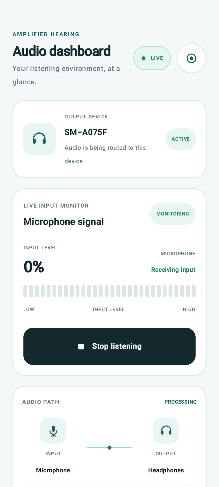
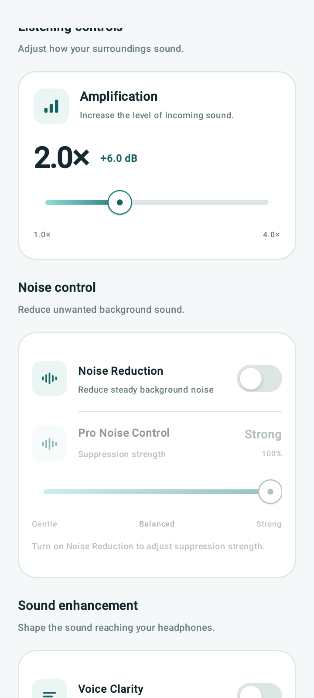
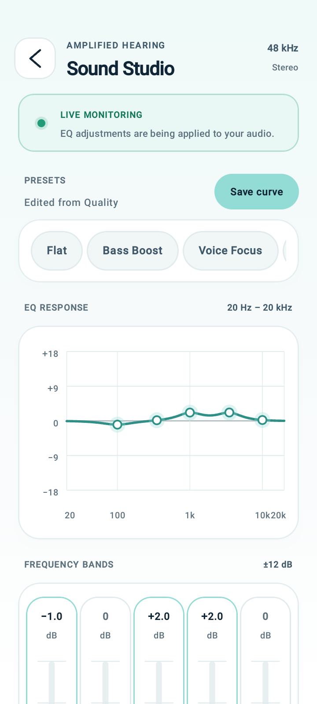
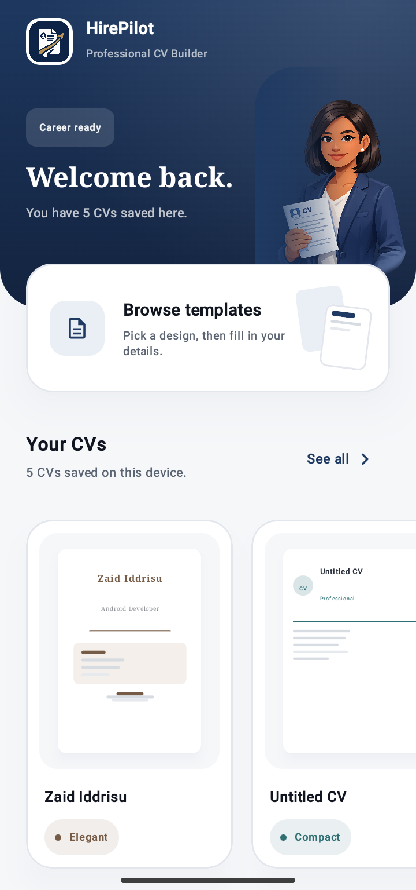
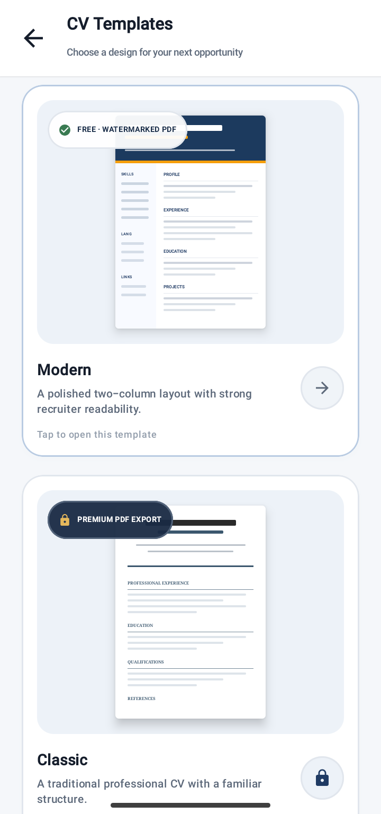
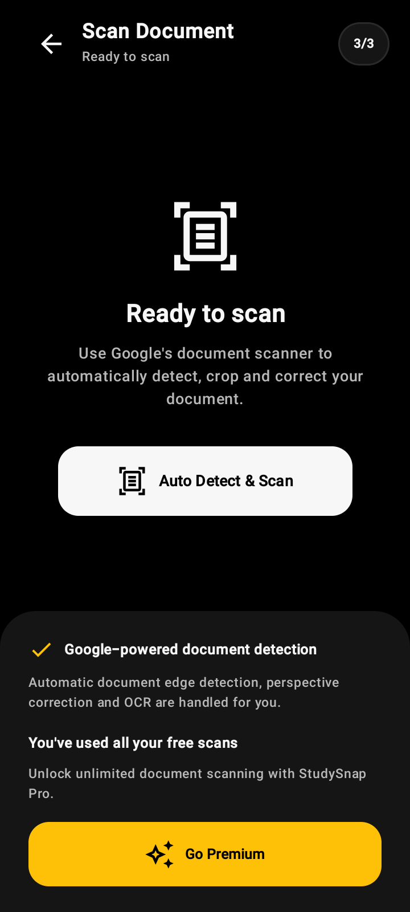
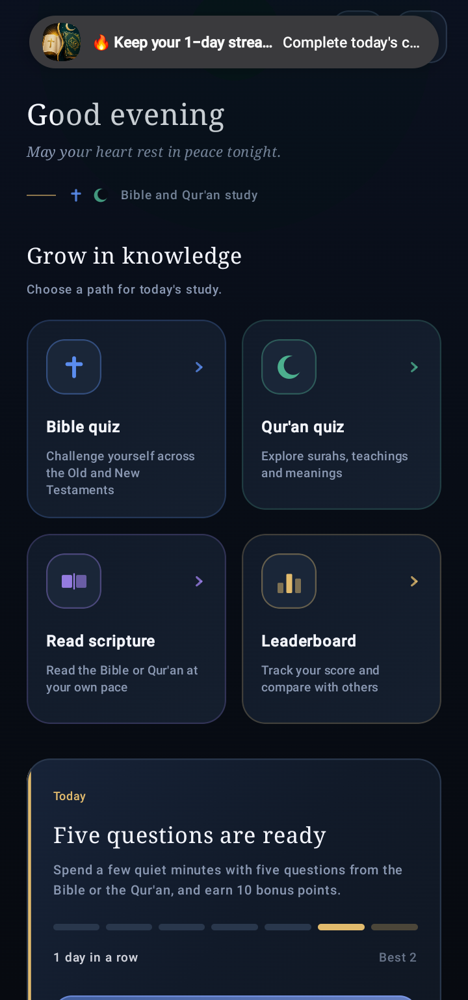

# ZID TECH | Android Developer

**Kotlin · Jetpack Compose · Firebase · Android Development**

I’m an independent Android developer from Ghana, focused on building, improving, and maintaining practical Android applications.

I work with modern Android technologies to develop user-focused interfaces, integrate backend services, implement app features, and prepare applications for Google Play.

## Featured Projects

### Amplified Hearing
An Android audio amplification application with real-time microphone processing, headphone routing, and customizable listening controls.

  
  
  

[View on Google Play](https://play.google.com/store/apps/details?id=com.mobivision.amplifiedhearing)

### HirePilot – CV Builder
A CV-building application with professional templates, offline saving, and PDF generation.

  
  

[View on Google Play](https://play.google.com/store/apps/details?id=com.zidtech.hirepilot)

### StudySnap – Document Scanner
A document scanning application built with Google ML Kit Document Scanner.

  

[View on Google Play](https://play.google.com/store/apps/details?id=com.zaididdrisu.studysnap)

### Bible & Quran Mastery
A learning application combining Bible and Quran reading, quizzes, daily challenges, bookmarks, and Firebase-powered features.

  

[View on Google Play](https://play.google.com/store/apps/details?id=com.zaididdrisu.quizapp)

## Technical Skills

| Area | Technologies |
|---|---|
| Language | Kotlin |
| UI Development | Jetpack Compose, Material Design |
| Backend | Firebase Authentication, Firestore, Realtime Database |
| Notifications | Firebase Cloud Messaging |
| Android | Android SDK, Android Studio |
| Integrations | Google Play Billing, ML Kit |
| Other | Android Audio APIs, PDF generation, Git, GitHub |

## Services

- Native Android application development
- Jetpack Compose UI implementation
- Firebase integration
- Google Play Billing integration
- Feature development and integration
- Bug fixing and app maintenance
- PDF and document-processing features

## Let's Work Together

I'm open to freelance projects, collaboration, and remote Android development opportunities.

**Email:** [zaididdrisu193@gmail.com](mailto:zaididdrisu193@gmail.com)

**GitHub:** [zaididdrisu193-lgtm](https://github.com/zaididdrisu193-lgtm)

---

*Designed and developed by ZID TECH.*
